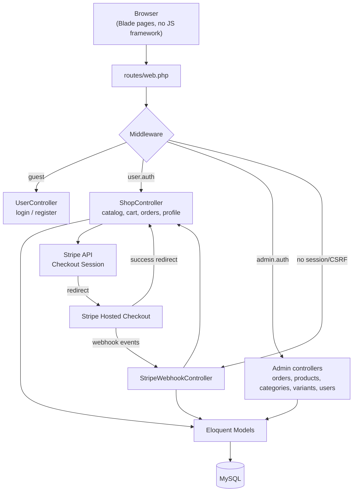
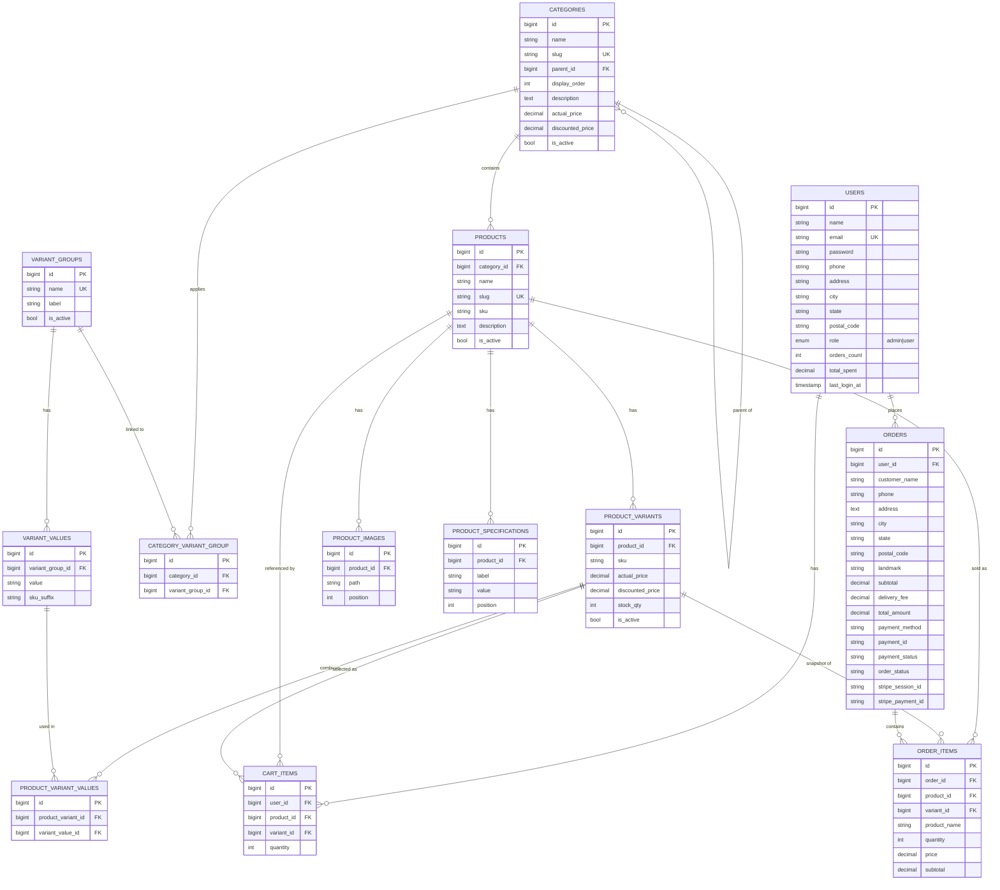
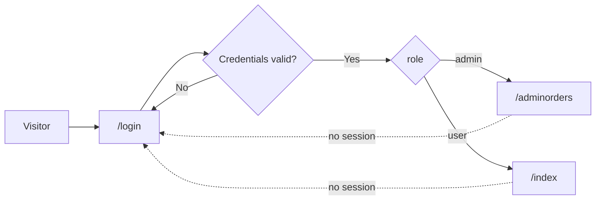
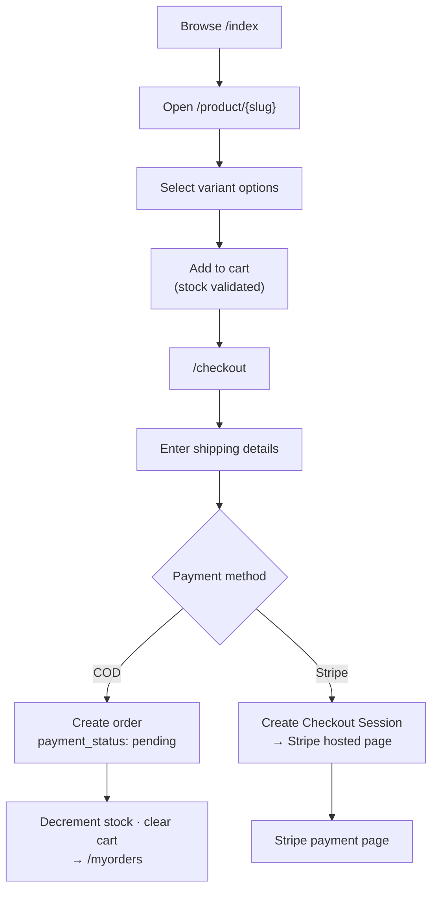
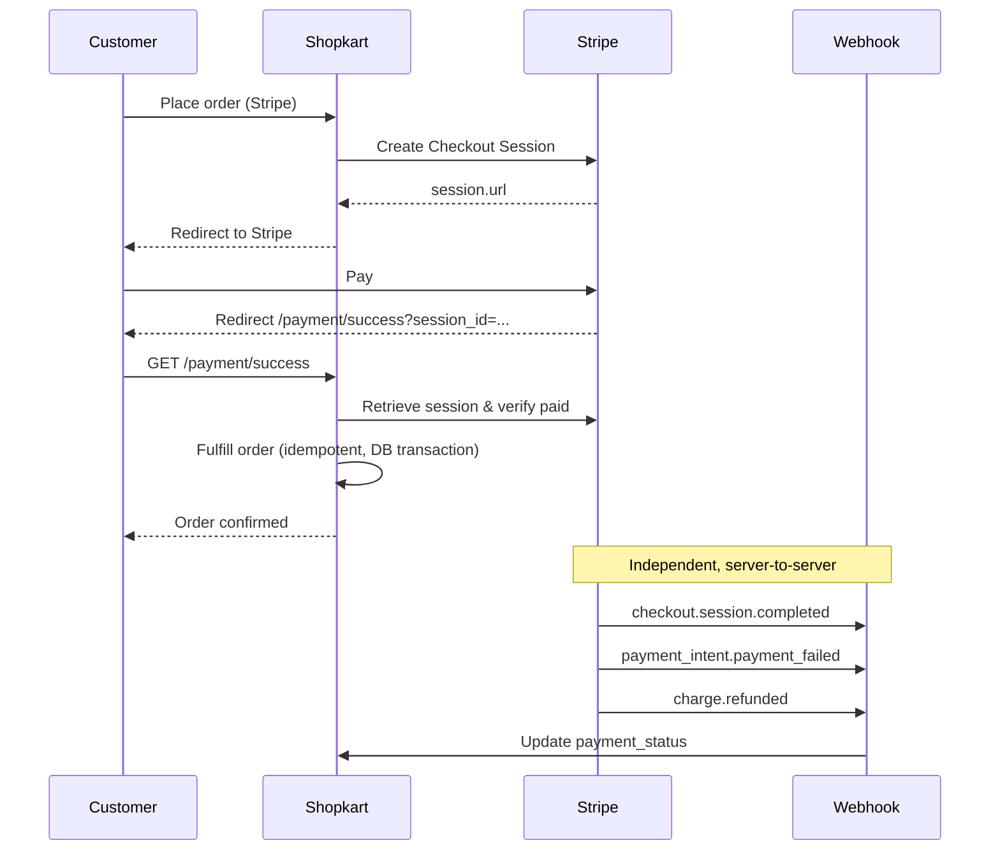
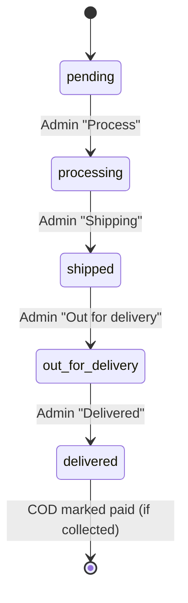
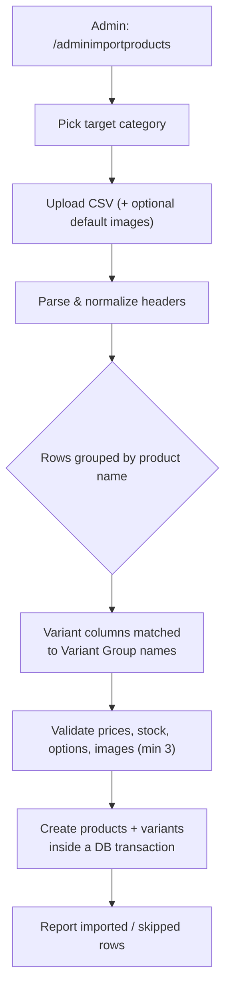

<div align="center">

# 🛒 Shopkart

**A full-stack e-commerce platform built with Laravel — storefront, variant-aware catalog, cart, COD + Stripe checkout, invoices and a complete admin panel.**


</div>

---

## 📖 Overview

Shopkart is a Laravel-based e-commerce application that covers the full shopping journey — from browsing a variant-driven catalog to paying with **Cash on Delivery** or **Stripe Checkout**, and then managing everything through an admin dashboard.

It is intentionally built **without a JavaScript framework**: every page is server-rendered with Blade templates, and all business logic lives in the controllers. Styling uses hand-written CSS in `public/assets/css/` (no build step required for styles).

**Highlights**

- 🧩 **Variant-aware catalog** — products are composed from reusable variant groups (e.g. *Color*, *Storage*) with per-variant pricing and stock.
- 💳 **Dual payment** — Cash on Delivery and Stripe Checkout, with webhook-driven failure/refund tracking.
- 📦 **Bulk CSV import** — import many products (and their variants) into a category in one upload.
- 🧾 **PDF invoices** — generated on demand for customers and admins.
- 🛠️ **Full admin panel** — orders, products, categories, variants, users and profile, plus a live pending-orders notification bar.

---

## 🖼️ Screenshots

> Drop your own PNGs into `docs/screenshots/` using the file names below and they will render here automatically.

| Storefront | Product Detail |
| :---: | :---: |
|  |  |

| Cart & Checkout | My Orders & Invoice |
| :---: | :---: |
|  |  |

| Admin — Orders | Admin — Order Detail |
| :---: | :---: |
|  |  |

| Admin — Products | Admin — Add Product |
| :---: | :---: |
|  |  |

| Admin — Categories | Admin — Variants |
| :---: | :---: |
|  |  |

| Login / Register | Admin — Users |
| :---: | :---: |
|  |  |

---

## ✨ Features

### Storefront (customer)

| Feature | Description |
| --- | --- |
| 🔐 Authentication | Custom session-based register / login / logout. Registration assigns the `user` role. |
| 🏠 Home catalog | Active products grid with category filter, search, stock badges and a featured product. |
| 🔎 Product detail | Image gallery, specifications and a **live variant matrix** — selecting options resolves price + stock. |
| 🧺 Cart | Add / update quantity / remove, with stock guards and a live savings total. |
| 💳 Checkout | Multi-step checkout with COD or Stripe, delivery fee logic and order summary. |
| 🧾 Orders | Order history split into active vs. previous, with downloadable **PDF invoices**. |
| 👤 Profile | Personal info, address book and password change (verified against the current password). |

### Admin panel

| Feature | Description |
| --- | --- |
| 📊 Orders dashboard | Status summary cards + full order list. |
| 🚚 Order detail | View line items, update delivery status, mark COD cash as collected, email the customer, download invoice. |
| 📦 Products | Paginated list, category filter, create / edit / delete (delete is blocked if referenced by orders). |
| 🧩 Variants | CRUD for variant groups (e.g. Color) and their values, linked to categories. |
| 🗂️ Categories | Hierarchical categories (parent/child) with pricing, ordering and unique slugs. |
| 📥 Bulk import | Upload a CSV, pick a target category, and import many products + variants at once. |
| 👥 Users | Read-only directory of registered customers with activity derived from last login. |
| 🔔 Notifications | Global bar showing the 5 most recent pending orders. |
| 🙍 Profile | Admin profile + password update. |

---

## 🧰 Tech Stack

| Layer | Technology |
| --- | --- |
| Language | PHP 8.3 |
| Framework | Laravel 13 |
| Database | MySQL (SQLite for tests) |
| Templating | Blade (server-rendered, no JS framework) |
| Styling | Hand-written CSS (`public/assets/css/*.css`), Tailwind + Vite available for app assets |
| Payments | Stripe PHP SDK v22 — Checkout Sessions + Webhooks |
| PDF | `barryvdh/laravel-dompdf` |
| Authentication | Custom session-based (no Jetstream/Breeze) |
| Testing | Pest 4 |
| Code style | Laravel Pint |

---

## 🏗️ Architecture



**Key architectural rules**

- All business logic lives in **controllers** — Blade views are layout/design only.
- Product/edit forms are **fully server-rendered**; no client-side data handling.
- `stripe/webhook` is excluded from CSRF protection (server-to-server calls).
- Admin partials (header, footer, sidebar, notification bar) are shared via Blade `@include`.

---

## 🗄️ Database Schema (ERD)



**Variant model in one sentence:** a `product` has many `product_variants`; each variant is a unique combination of `variant_values` (e.g. *Black + 128GB*) and carries its own price and stock. Variant groups are reusable and can be attached to specific categories.

---

## 🔄 Core Flows

### 1. Authentication & Routing



Sessions store `user_id`, `user_name` and `user_role`. Two aliases guard the app: `user.auth` (storefront) and `admin.auth` (admin panel).

### 2. Shopping → Cart → Checkout



### 3. Stripe Payment & Webhook Lifecycle



**Important behaviour**

- Fulfillment is **idempotent** — refreshing the success page never creates a duplicate order.
- The charged amount is verified against the recomputed order total before the order is written.
- Stock is reserved inside a `DB::transaction` with `lockForUpdate()`.
- Webhooks are used strictly for **failure and refund tracking**; a successful payment is confirmed by the browser redirect.

### 4. Order Lifecycle



`order_status` (delivery) and `payment_status` (`pending` / `paid` / `failed` / `refunded`) are tracked independently.

### 5. Bulk CSV Import



- Rows sharing the same product name become **variants of one product**.
- A column is treated as a variant column when its header matches a **Variant Group** name (e.g. `color`, `storage`).
- Specifications use `Label=Value|Label=Value`; images are comma-separated paths or uploaded defaults.
- Missing options are reported per row (auto-create is disabled by default).

---

## 📁 Project Structure

```text
app/
├── Http/
│   ├── Controllers/
│   │   ├── ShopController.php              # storefront: catalog, cart, orders, Stripe
│   │   ├── UserController.php              # auth, profile, address, security
│   │   ├── AdminController.php             # orders, order status, admin profile, email, invoice
│   │   ├── AdminProductController.php      # product CRUD
│   │   ├── AdminProductImportController.php# bulk CSV import
│   │   ├── AdminCategoryController.php     # category CRUD
│   │   ├── AdminVariantController.php      # variant group / value CRUD
│   │   ├── AdminUserController.php         # users directory
│   │   └── StripeWebhookController.php     # Stripe webhook handler
│   └── Middleware/
│       ├── EnsureUserLoggedIn.php          # alias: user.auth
│       └── AdminAccess.php                 # alias: admin.auth
├── Mail/orderMail.php                      # order email
├── Models/                                 # Eloquent models
└── Providers/AppServiceProvider.php        # shares pending orders with the notification bar

database/
└── migrations/                             # full schema (see ERD)

public/
├── assets/css/                             # hand-written per-page CSS
├── assets/images/                          # static images
└── uploads/products/                       # uploaded product images

resources/views/
├── user/                                   # storefront (index, product, checkout, profile, orders)
├── admin/                                  # admin panel + partials (sidebar, notification bar)
├── emails/order-mail.blade.php
└── pdf/invoice.blade.php

routes/web.php                              # all routes
tests/Feature/                              # Pest feature tests
```

---

## 🚀 Getting Started

### Requirements

- PHP **8.3+** with the `pdo_mysql` extension
- Composer 2
- Node.js 18+ (only for Vite-compiled app assets; the storefront CSS is plain and needs no build)
- MySQL 8 (or point `DB_CONNECTION` at SQLite)

### Installation

```bash
# 1. Clone
git clone <your-repo-url> shopkart
cd shopkart

# 2. Install PHP dependencies
composer install

# 3. Environment file + app key
copy .env.example .env      # Windows
# cp .env.example .env      # macOS / Linux
php artisan key:generate

# 4. Create the database, then configure .env (see below)
# 5. Run migrations
php artisan migrate

# 6. Build front-end assets (optional for the Blade storefront CSS)
npm install
npm run build

# 7. Serve
php artisan serve
```

Open **http://localhost:8000** and log in at `/login`.

### Environment variables

```dotenv
APP_NAME=Shopkart
APP_URL=http://localhost:8000

DB_CONNECTION=mysql
DB_HOST=127.0.0.1
DB_PORT=3306
DB_DATABASE=ecommerce
DB_USERNAME=root
DB_PASSWORD=

MAIL_MAILER=log

STRIPE_KEY=pk_test_xxxxxxxxxxxxxxxxxxxxx
STRIPE_SECRET=sk_test_xxxxxxxxxxxxxxxxxxxxx
STRIPE_WEBHOOK_SECRET=whsec_xxxxxxxxxxxxxxxxxxxxx
```

> ⚠️ `STRIPE_WEBHOOK_SECRET` must be the **signing secret** (`whsec_...`), not the account id (`acct_...`). After editing `.env`, always run `php artisan config:clear`.

### Creating an admin user

Registration always creates a `user`. Promote an account directly:

```bash
php artisan tinker --execute "App\Models\users::where('email','admin@example.com')->update(['role' => 'admin']);"
```

Then log in — an admin is redirected to `/adminorders`.

### Stripe webhooks (local)

```bash
stripe login
stripe listen --forward-to localhost:8000/stripe/webhook \
  --events checkout.session.completed,payment_intent.payment_failed,charge.refunded
```

Copy the printed `whsec_...` into `STRIPE_WEBHOOK_SECRET`.

> The webhook route is **POST-only** — opening it in a browser returns `405 Method Not Allowed`, which is expected.

---

## 🧪 Testing

```bash
# Run the full suite
php artisan test --compact

# Run a single file
php artisan test tests/Feature/ShopProductTest.php

# Or use Pest directly
vendor/bin/pest
```

Feature tests currently cover the product catalog and the user profile flows.

### Code style

```bash
vendor/bin/pint --dirty --format agent
```

---

## 🗺️ Route Reference

### Public / Guest

| Method | URI | Action |
| --- | --- | --- |
| GET | `/` | Redirect to login |
| GET / POST | `/login` | Login form / authenticate |
| GET / POST | `/register` | Registration form / create account |
| POST | `/stripe/webhook` | Stripe webhook (no CSRF) |

### Storefront (`user.auth`)

| Method | URI | Action |
| --- | --- | --- |
| GET | `/index` | Product catalog |
| GET | `/product/{slug}` | Product detail |
| POST | `/add-to-cart` | Add to cart / Buy now |
| GET | `/cart` | Cart |
| POST | `/cart/update/{id}` | Update quantity |
| POST | `/cart/remove/{id}` | Remove item |
| GET | `/checkout` | Checkout |
| POST | `/place-order` | Place order (COD or Stripe) |
| GET | `/myorders` | My orders |
| GET | `/myorders/{id}/invoice` | Download PDF invoice |
| GET | `/profile` | Profile dashboard |
| POST | `/profile/update` · `/profile/address` · `/profile/security` | Update profile sections |
| POST | `/logout` | Logout |

### Admin (`admin.auth`)

| Method | URI | Action |
| --- | --- | --- |
| GET | `/adminorders` | Orders dashboard |
| GET | `/adminorderdetail/{id}` | Order detail |
| PATCH | `/adminorderdetail/{id}/status` | Update status |
| POST | `/adminorderdetail/{id}/send-email` | Email customer |
| GET | `/adminorderdetail/{id}/invoice` | Download invoice |
| GET | `/adminproducts` | Product list |
| GET / POST | `/adminaddproduct` | Add product |
| GET / POST | `/admineditproduct/{product}` | Edit product |
| DELETE | `/adminproducts/{product}` | Delete product |
| GET / POST | `/adminimportproducts` | Bulk CSV import |
| GET | `/adminimportproducts/sample` | Download sample CSV |
| GET | `/admincategories` · `/adminaddcategory` · `/admineditcategory/{id}` | Categories |
| GET | `/adminvariants` · `/adminaddvariant` · `/admineditvariant/{id}` | Variants |
| GET | `/adminusers` | Users directory |
| GET / POST | `/adminprofile` · `/adminpassword` | Admin profile & password |

---

## 📄 License

Released under the [MIT License](https://opensource.org/licenses/MIT).

<div align="center">

Built with ❤️ using [Laravel](https://laravel.com).

</div>
